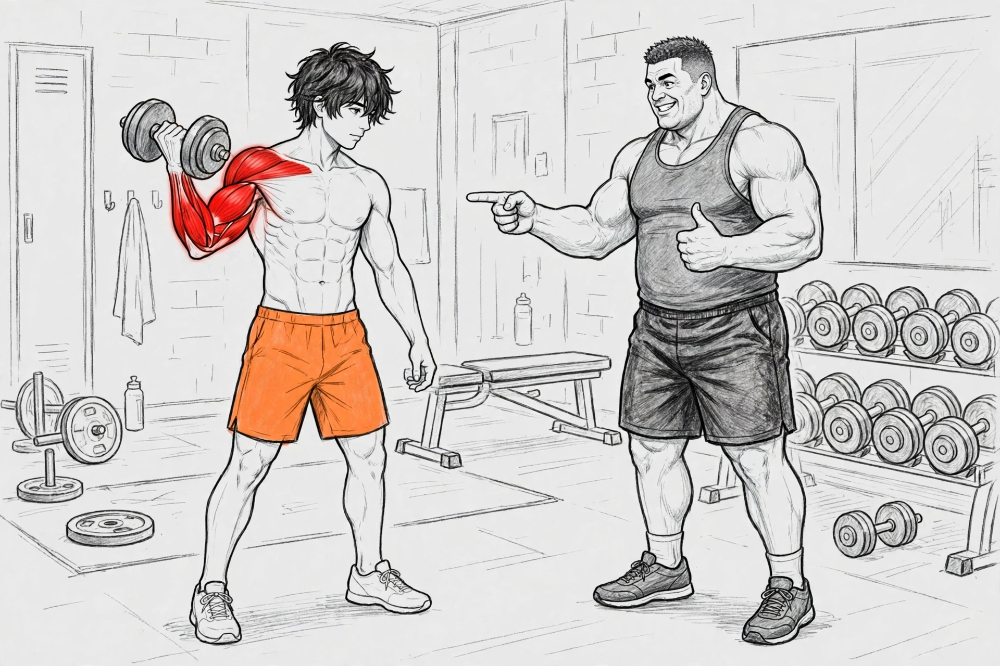

# Gym Content Creation

A skill for planning gym content for Reels, TikTok and Shorts, in two modes:

- **Mode A — Filmed:** a real person films in a gym or at home. The skill produces a Phase A proposal first, then a shot-by-shot filming checklist and publishing kit.
- **Mode B — Faceless:** AI-generated explainers with the locked 2.5D sketch duo below. The skill produces standalone per-clip video prompts, one per clip.

The full instructions live in `SKILL.md`.

## Characters (Mode B)

- **The Coach** — bulky, drawn in grey pencil sketch (dark grey tank top, black shorts). He teaches, points at the working muscle, corrects form and celebrates the fix with a thumbs up. He narrates in a deep, strong, warm coaching voice.
- **The Student** — lean, messy dark hair, grey sketch body, bright orange shorts and white trainers. He demonstrates every exercise — first the common mistake, then the correct form. The muscle being trained glows bright red with anatomy detail while it works.

Full character anchors, the muscle-glow rule and the frozen voice blocks: `references/gym-character.md`. Character sheets: `assets/gym-coach-sheet.png` and `assets/gym-student-sheet.png`.

## Sample video

https://github.com/user-attachments/assets/d533c70c-3a08-4ad8-933a-2081990dcebc

The 10-second duo test animation: the Student does slow dumbbell curls while his biceps glow red, the Coach points at the working muscle and finishes with a thumbs up. The file also lives at `examples/duo-test-animation.mp4`.
